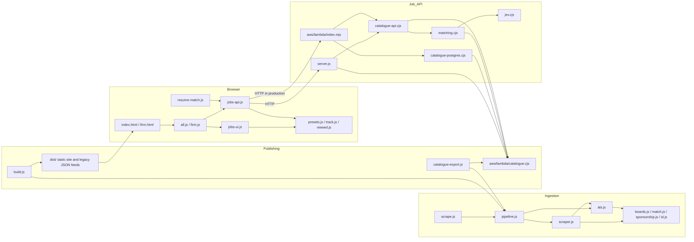

# Code architecture audit

Snapshot: 2026-10-01 working tree. This audit maps 44 runtime JavaScript files (excluding tests, dependencies, and generated output) with an AST parser. The companion [AST map](ast-map.json) records each file's function locations and lengths, local imports, and browser global reads and writes. The [generated dependency graphs](dependency-graph.md) contain every detected module import, page script load, and direct browser-global read. Rerun the scan with `node --expose-internals tools/map-code.cjs`. HTML script tags were mapped separately because they define runtime dependencies outside the JavaScript AST.

## Dependency graph

Arrows mean “depends on” or “calls.” The browser-to-API arrow is an HTTP call; the other server arrows are module imports.

The browser graph hides a second form of coupling: script order and `window` globals. Both job pages load `jobs-ui.js`, `jobs-api.js`, `presets.js`, and `filter-drawer.js` before their page entry point. `all.js` and `firm.js` write `window.JobView`; `resume-match.js` reads it. `jobs-api.js` writes `window.JobsAPI` and `window.JobsData`; `jobs-ui.js` reads `window.Seen`, `window.JobsData`, and `window.Presets`. These links are recorded in `ast-map.json` but are invisible to normal import tooling.

The generated map captures literal imports, page script tags, and direct `window`/`global` property references. It does not resolve bare classic-script globals such as `VC_FIRMS`, dynamic property names, HTTP routes, SQL dependencies, or CSS. The scanner uses Node's bundled Acorn parser through `--expose-internals`; that internal path should be checked if the project upgrades Node.

## AST hotspots

| File / function | Size | Why it matters |
|---|---:|---|
| `jobs-ui.js` / `createJobsView` | 1,110 lines; file has 186 function nodes | Filtering, remote requests, rendering, URL state, undo, facets, grouping, and pagination share one closure. |
| `jobs-ui.js` / `createPicker` | 122 lines | Picker state and DOM work are coupled to the view. |
| `pipeline.js` / `runScrape` | 110 lines | Discovery, ATS enrichment, mutation, and merging are in one orchestration function. |
| `aws/lambda/index.mjs` / `handler` | 191 lines | Catalogue import, job API routing, analytics, feedback, and admin counts share one entry point. |
| `aws/lambda/catalogue.cjs` | 7 runtime importers | Shared request rules and the local in-memory implementation live in the same module. |

AST totals: 44 files, 748 function nodes, about 7,768 source lines, 33 module edges, 39 page script edges, and 23 direct browser-global edges. No static module import cycles were found. Counts include callbacks and browser IIFEs; they measure structure, not quality by themselves.

## Recommended changes, in order

| Priority | Evidence | Change |
|---|---|---|
| 1 | [Both page entries](../all.js) use `loadPage: JobsAPI.search`; [the view](../jobs-ui.js) still has client-side `filtered`, `sortJobs`, `buildGroups`, `setJobs`, and a separate remote path. | Add characterization tests for URL history, presets, grouped cards, and paging. Then remove the unused local-data branch and split rendering, filter state, and URL/undo into small modules. Preserve the current API and HTML while doing this incrementally. |
| 1 | [Browser dimensions](../jobs-ui.js) and [API dimensions/normalization](../aws/lambda/catalogue.cjs) are maintained separately. | Put filter keys, accepted sorts/ranges, and serialization rules in one shared contract, or at minimum add a parity test that fails when browser and API keys diverge. Keep UI labels and DOM code browser-specific. |
| 1 | [The catalogue exporter](../catalogue-export.js) imports `allJobsPayload` from [the scrape pipeline](../pipeline.js), which imports both scrapers and ATS code. The build and local server do likewise for pure payload functions. | Move payload builders into a side-effect-free module. Let the pipeline import and re-export them temporarily so callers can migrate without a large rewrite. |
| 2 | [Catalogue core](../aws/lambda/catalogue.cjs) is imported by seven runtime modules, including production SQL and AI matching, but also contains the local `MemoryCatalogue`. | Separate the shared query contract and job summary helpers from the in-memory adapter. Then SQL, matching, and import code need not depend on local storage logic. |
| 2 | [Lambda handler](../aws/lambda/index.mjs) handles five unrelated request families and catalogue import in one 191-line function. | Extract route handlers for analytics/feedback, job API, and import. Keep the exported handler as a small dispatcher. |
| 2 | [Local catalogue search](../aws/lambda/catalogue.cjs) filters the job array for every company when building groups and again for each facet. | Build grouped rows in one pass and reuse filtered subsets where possible. Benchmark with a representative catalogue before changing the SQL implementation. |
| 3 | [The old Cloudflare Worker](../worker/index.js) duplicates the analytics routes in Lambda, while [API configuration](../api-config.js) points the browser to Lambda. [README](../README.md) also says both 45 and 65 jobs per page and still describes the static feed as the browser path. | Mark the Worker as legacy or archive it after checking deployment dependencies; update documentation to describe the current API path and page size. Keep static JSON outputs that are still used by tools such as `feature-pick.js`. |

One data-flow concern deserves a focused check during the pipeline split: [salary carry-over in `runScrape`](../pipeline.js) assigns to ATS job objects while looping over investor boards. Those ATS objects can be shared across firms, so the first board's salary may influence another firm's merged copy. Clone the job before applying board-specific enrichment, then compare output on a multi-investor fixture.

## Verification and scope

`npm test` ran 44 tests: 42 passed, one PostgreSQL integration test was skipped because `TEST_DATABASE_URL` is unset, and the local HTTP test could not bind `127.0.0.1` in this sandbox (`EPERM`). The CI workflow supplies a PostgreSQL service and runs both unit and browser tests. No production source was changed for this audit.
