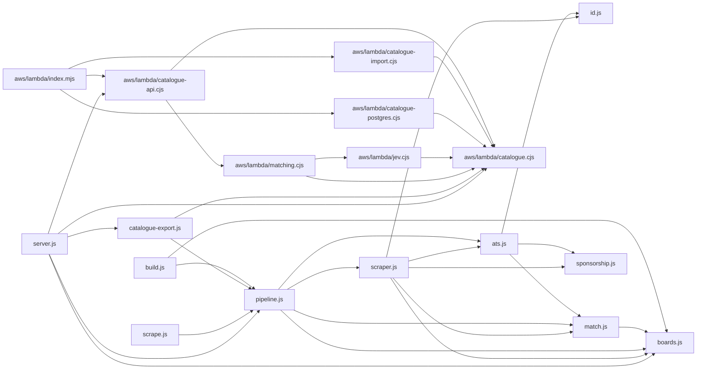
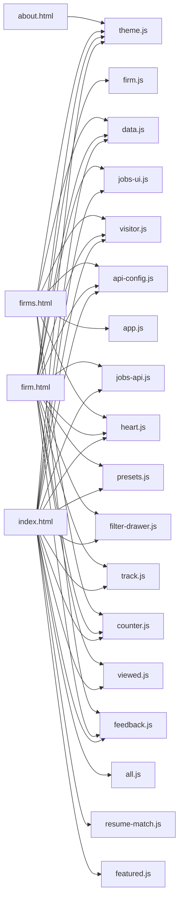
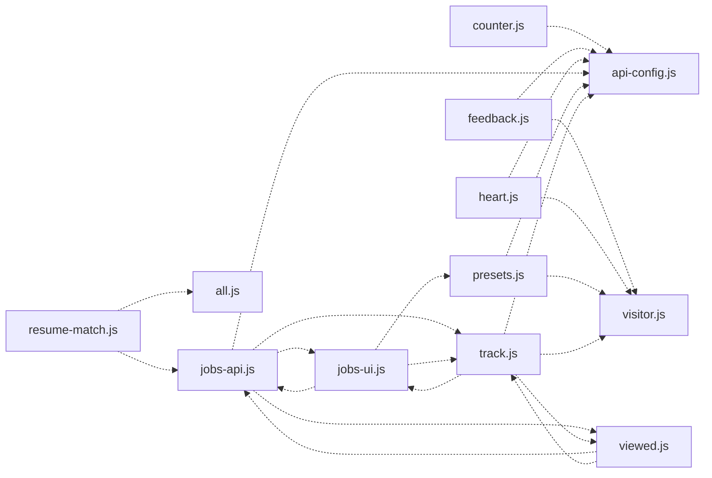

# Generated dependency graphs

Run `node --expose-internals tools/map-code.cjs` from the repository root to update this file and [the AST map](ast-map.json).

These arrows are direct static dependencies. The module diagram includes literal `require` and `import` targets. The page diagram shows scripts loaded by each HTML page; it does not claim every script calls every other script. The global diagram covers direct property reads; dynamic calls and bare global identifiers need manual review.

## Module imports

## Browser script loads

## Implicit browser globals

Dashed arrows show direct `window`/`global` property reads, from consumer to producer, where both scripts load on the same page. Bare identifiers such as `VC_FIRMS` and `JobsAPI` may add further coupling and require scope-aware analysis.

| Consumer | Provider | Global |
|---|---|---|
| `counter.js` | `api-config.js` | `API_ENDPOINT` |
| `feedback.js` | `api-config.js` | `API_ENDPOINT` |
| `feedback.js` | `visitor.js` | `Visitor` |
| `heart.js` | `api-config.js` | `API_ENDPOINT` |
| `heart.js` | `visitor.js` | `Visitor` |
| `jobs-api.js` | `api-config.js` | `API_ENDPOINT` |
| `jobs-api.js` | `api-config.js` | `JOBS_ENDPOINT` |
| `jobs-api.js` | `jobs-ui.js` | `JobsUI` |
| `jobs-api.js` | `track.js` | `Seen` |
| `jobs-api.js` | `viewed.js` | `Viewed` |
| `jobs-ui.js` | `jobs-api.js` | `JobsData` |
| `jobs-ui.js` | `presets.js` | `Presets` |
| `jobs-ui.js` | `track.js` | `Seen` |
| `presets.js` | `api-config.js` | `API_ENDPOINT` |
| `presets.js` | `visitor.js` | `Visitor` |
| `resume-match.js` | `all.js` | `JobView` |
| `resume-match.js` | `jobs-api.js` | `JobsAPI` |
| `track.js` | `api-config.js` | `API_ENDPOINT` |
| `track.js` | `jobs-ui.js` | `JobsUI` |
| `track.js` | `viewed.js` | `Viewed` |
| `track.js` | `visitor.js` | `Visitor` |
| `viewed.js` | `jobs-api.js` | `JobsData` |
| `viewed.js` | `track.js` | `Seen` |

## Browser script order

- **index.html:** `theme.js` → `data.js` → `jobs-ui.js` → `visitor.js` → `api-config.js` → `jobs-api.js` → `heart.js` → `presets.js` → `filter-drawer.js` → `all.js` → `resume-match.js` → `track.js` → `viewed.js` → `counter.js` → `featured.js` → `feedback.js`
- **firm.html:** `theme.js` → `data.js` → `jobs-ui.js` → `visitor.js` → `api-config.js` → `jobs-api.js` → `heart.js` → `presets.js` → `filter-drawer.js` → `firm.js` → `track.js` → `viewed.js` → `counter.js` → `feedback.js`
- **firms.html:** `theme.js` → `data.js` → `app.js` → `visitor.js` → `api-config.js` → `heart.js` → `counter.js` → `feedback.js`
- **about.html:** `theme.js`

## Standalone files

These files have no local module edge and are not loaded by the four HTML pages. This includes command-line entry points and the separate Cloudflare Worker; it is not a dead-code finding by itself.

- `aws/export-d1.js`
- `aws/import-catalogue.js`
- `aws/package-lambda.js`
- `feature-pick.js`
- `refresh.js`
- `stats.js`
- `sync-jobs.js`
- `worker/index.js`
